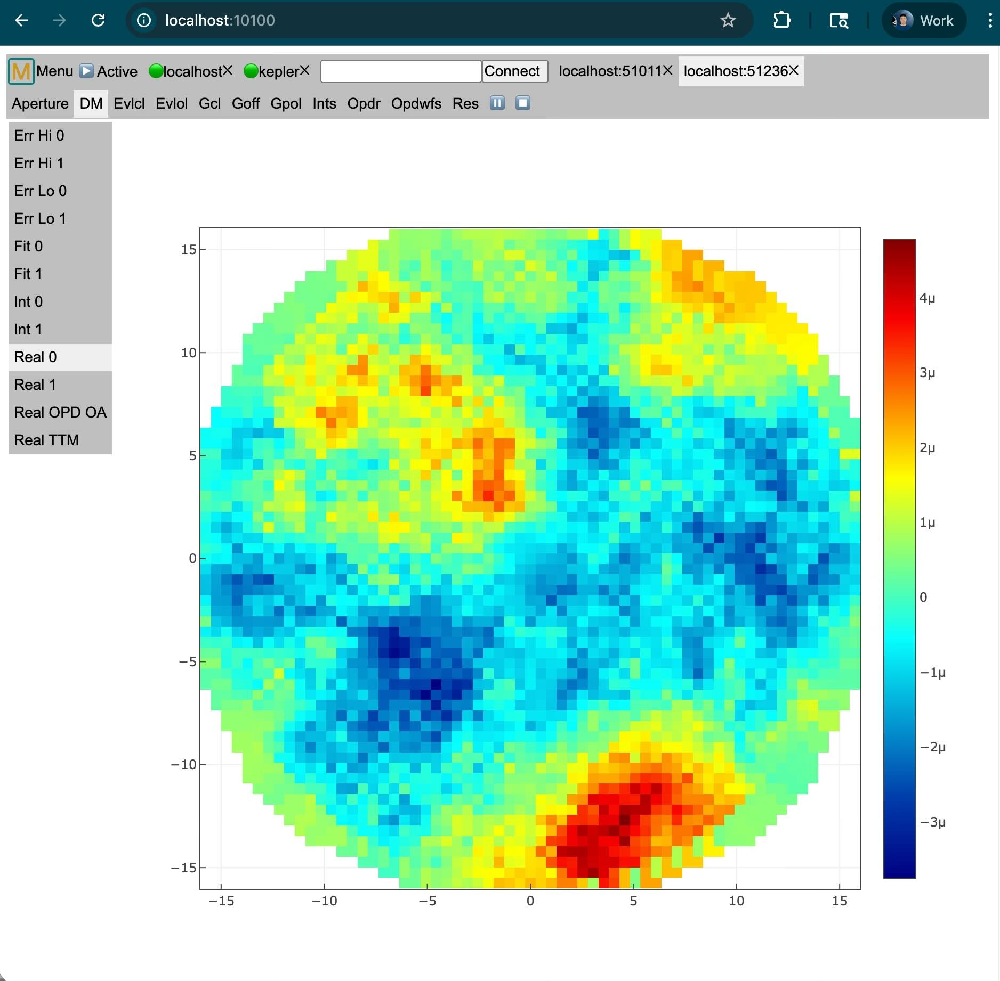
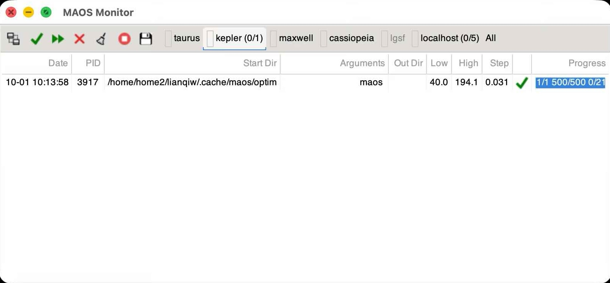
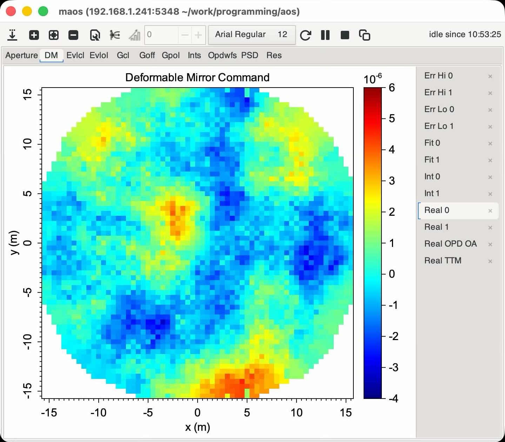

\page page20_compile  Compile the Code

\tableofcontents

# Quick start {#compile-quick}

```
git clone https://github.com/lianqiw/maos.git ~/work/maos/src
cd ~/work/maos/src && ./autogen.sh
mkdir ~/work/maos/optim && cd ~/work/maos/optim
../src/configure
make -j8
make check   #optional: run the unit tests
bin/maos     #run the default simulation (TMT NFIRAOS)
```

The sections below explain each step and the available options.

# Prerequisites {#compile-prereq}

MAOS runs on POSIX platforms: Linux and macOS are built and tested in
continuous integration. Windows users can use WSL. The BSDs may work but are
not tested.

Required:

- A C11 compiler with GNU extensions: GCC, Clang (including Apple Clang), or
  the Intel compilers (icx or the classic icc). A C++ compiler (`g++` or
  `clang++`) can also be used, see \ref compile-cpp.
- `make`, `tar`, `bzip2`, `which`, and `curl` or `wget` (used by `configure`
  to download missing libraries).
- Python 3. It is used during the build to generate the MATLAB interface
  source `mex/aolib.c`.
- When building from the git repository: autoconf, automake, and libtool.
- zlib, BLAS and LAPACK, FFTW 3, and CHOLMOD (SuiteSparse). `configure`
  downloads FFTW and CHOLMOD (and Intel MKL as BLAS/LAPACK on x86-64 Linux)
  when they are not found, see \ref compile-deps. zlib and BLAS/LAPACK should
  be installed from the system package manager.

Optional:

- CUDA toolkit 7.0 or later: GPU acceleration, see \ref compile-gpu.
- GTK 3 or GTK 4 (GTK 2 is still accepted) with cairo: the `drawdaemon` and
  `monitor` programs, see \ref compile-gui. libnotify enables desktop
  notifications in `monitor`. On macOS, gtk-mac-integration is used if found.
- CMocka: unit tests. Downloaded if not found.
- MATLAB: the mex interface, see \ref compile-mex.
- zstd (1.5 or later): reading and writing zstd compressed files.
- OpenSSL: HTTPS for the browser based monitor.
- libwebsockets: an additional websocket server, see \ref compile-browser.
  Requires `cmake` when it has to be compiled from source.
- Doxygen: building this manual with `make doc`.

On Debian/Ubuntu, the libraries used in continuous integration are installed with
```
sudo apt-get install autoconf automake libtool make bzip2 zlib1g-dev \
  libfftw3-dev libsuitesparse-dev libcmocka-dev libopenblas-openmp-dev
```
Add `libgtk-3-dev` (or `libgtk-4-dev`) for the graphical tools and
`nvidia-cuda-toolkit` for GPU support. On Fedora/RHEL, use `dnf` with the
corresponding `-devel` packages (e.g., `fftw-devel`, `suitesparse-devel`,
`openblas-devel`). On macOS, use Homebrew (https://brew.sh/):
```
brew install autoconf automake libtool make fftw suite-sparse cmocka libomp gtk4 libwebsockets
```
If `autoreconf` is missing, `autogen.sh` offers to install the basic tools with
`apt`, `dnf`, `brew`, or `port`.

# Download the code {#compile-download}

We recommend separate folders for 1) the source code, 2) the build (one folder
per set of build options), and 3) running simulations. In this page `$src_dir`
refers to the source folder.

## Git (preferred) {#compile-git}

The git repository is always up to date:
```
cd ~/work/maos
git clone https://github.com/lianqiw/maos.git src
cd src
./autogen.sh
export src_dir=$(pwd)
```
Run `git pull` to update. `autogen.sh` (which calls `autoreconf -i`) is needed
after a fresh clone; afterwards `make` reruns the autotools by itself when
`configure.ac` or a `Makefile.am` changes.

## Tagged snapshot {#compile-snapshot}

A tagged version, for example v3.4:
```
cd ~/work/maos
curl -L https://github.com/lianqiw/maos/archive/refs/tags/v3.4.tar.gz -o maos-3.4.tar.gz
tar xf maos-3.4.tar.gz
cd maos-3.4
./autogen.sh
export src_dir=$(pwd)
```

## Release tarball {#compile-release}

Some releases include a source tarball that already contains `configure`, so
the autotools are not needed. Do not modify `configure.ac` or `Makefile.am`
in this case; that would trigger regeneration of `configure` and require the
autotools.
```
cd ~/work/maos
curl -L https://github.com/lianqiw/maos/releases/download/v2.8/maos-2.8.0.tar.gz -o maos-2.8.0.tar.gz
tar xf maos-2.8.0.tar.gz
cd maos-2.8.0
export src_dir=$(pwd)
```

## Pre-compiled binaries {#compile-binary}

Release v2.8 also provides pre-compiled binaries. They are older than the
source code and do not include the job scheduler and monitor.
```
cd ~/work/maos
#choose one of the following:
curl -LO https://github.com/lianqiw/maos/releases/download/v2.8/maos_linux_amd64-2.8.0.tar.bz2   #Linux x86-64
curl -LO https://github.com/lianqiw/maos/releases/download/v2.8/maos_macos_amd64-2.8.0.tar.bz2   #macOS Intel
curl -LO https://github.com/lianqiw/maos/releases/download/v2.8/maos_macos_aarch64-2.8.0.tar.bz2 #macOS Apple silicon
tar xf maos_*.tar.bz2
```

# Build {#compile-build}

MAOS is always built out of tree, in a folder different from the source:
```
cd ~/work/maos
mkdir optim && cd optim
$src_dir/configure
make -j8
```
You can replace `optim` with any name, and keep several build folders side by
side with different options, for example:
```
~/work/maos/src       #source code
~/work/maos/optim     #$src_dir/configure
~/work/maos/debug     #$src_dir/configure --enable-debug
~/work/maos/release   #$src_dir/configure --enable-release
~/work/maos/cpp       #$src_dir/configure CC=clang++
```
At the end, `configure` prints a summary of the detected compiler, precision,
OpenMP, CUDA, GTK, MATLAB, and Doxygen support. The details of all checks are
in `config.log`.

The programs are placed in the `bin` subfolder of the build folder:

- `maos`: the simulator. See \ref page30_run.
- `skyc`: the sky coverage post-processor. See \ref skycoverage.
- `scheduler`: the job scheduler and web server for the monitors. It is
  started automatically by `maos` (not built with `--disable-scheduler` or
  `--enable-release`).
- `monitor` and `drawdaemon`: the GTK job monitor and plotting program (only
  when GTK is found; `monitor` also needs the scheduler).
- `drawres`, `drawbin`: plot results or `.bin` files with `drawdaemon`.
- `bin2fits`, `readbin`, `psfiris`, `psfgc`, `mvm_cpu`, `ethtest`: utilities.
  `load` and `record_cpu` are built on Linux only.
- `aolib.so`: the `lib` routines as a shared library for Python, see
  \ref compile-python.

On macOS, application bundles `drawdaemon.app` and `monitor.app` are also
created in `bin`. Running `make` inside `bin` rebuilds the whole build folder.

`make install` is not needed. Add the `bin` folder to `PATH` instead (e.g., in
`.bash_profile` or `.zshenv`). The executables find the configuration files in
the source folder (`$src_dir/config`), whose path is compiled in. If the source
folder is moved, set `MAOS_CONFIG_PATH` to the folder that contains `config`
(see \ref page30_run). The browser monitor also serves its files from
`$src_dir/tools`, so keep the source folder in place.

# Configure options {#compile-options}

Options are passed to `configure`. The most useful ones are:

| Option | Default | Effect |
|--------|---------|--------|
| `--enable-debug` | off | Compile with `-g3 -O0` and enable debug checks. The default is `-g -O3 -mtune=native`. |
| `--enable-gcov` | off | Code coverage with gcov (implies `--enable-debug`). `make check` then produces an lcov report if lcov is installed. |
| `--enable-release` | off | Build for compatibility: disables the scheduler (hence `monitor` and the browser monitor). On macOS, targets macOS 11.0 or later. |
| `--disable-scheduler` | enabled | Do not build the job scheduler and `monitor`. Useful on clusters with their own job management. |
| `--disable-double` (or `--enable-single`) | double | Use single precision on both CPU and GPU. See \ref compile-single. |
| `--disable-openmp` | enabled if found | Do not use OpenMP; only POSIX threads are used. |
| `--enable-openmp` | | On macOS, download or compile libomp if it is not found. |
| `--disable-threadlib` | threaded | Use the serial versions of FFTW, MKL and OpenBLAS. |
| `--enable-mkl` | off | On x86-64 Linux, prefer Intel MKL for BLAS/LAPACK and download it if not installed. |
| `--disable-dlong` | long if available | Do not use the long integer (`cholmod_l_*`) CHOLMOD interface. |
| `--disable-binary` | enabled | Compile missing libraries from source instead of downloading pre-compiled ones. |
| `--disable-download` | enabled | Do not download anything. Missing required libraries cause an error. |
| `--with-cuda[=DIR]` / `--without-cuda` | auto | CUDA toolkit location, or disable CUDA. See \ref compile-gpu. |
| `--with-ccbin=CC` | `$CC` | Host compiler passed to `nvcc -ccbin`. |
| `--enable-cuda-double` | off | Use double precision on the GPU. |
| `--enable-nvcc` | off | Use `nvcc` for the CUDA code even when `CC` is clang. |
| `--with-matlab[=DIR]` / `--without-matlab` | auto | MATLAB location for the mex interface, or disable it. See \ref compile-mex. |
| `--disable-gtk-3`, `--disable-gtk-4`, `--enable-gtk-4` | GTK 3 | Select the GTK version. See \ref compile-gui. |
| `--enable-cmocka` / `--disable-cmocka` | enabled | Unit tests with CMocka. |
| `--disable-zstd` | enabled if found | Do not use zstd compression. |
| `--enable-libwebsockets` | off | Also serve the browser monitor with libwebsockets. |
| `--with-openssl=DIR` | auto | OpenSSL location (HTTPS for the browser monitor). |
| `--enable-doxygen` | off | Download doxygen (and a TeX distribution) if not installed, for `make doc`. |
| `--prefix=DIR` | `~/.aos` | Where downloaded and compiled libraries are installed. |

Run `$src_dir/configure --help` for the complete list. To change options, it
is simplest to configure again in a new, empty build folder.

## Compilers {#compile-compilers}

The default compiler of the system is used. Select another one with `CC`:
```
$src_dir/configure CC=clang  #clang. Also compiles the CUDA code, see below.
$src_dir/configure CC=icx    #Intel oneAPI compiler
$src_dir/configure CC=gcc-14 #a specific gcc version
```
The environment variable `MAOS_CC` is used as the compiler when `CC` is not
set. `configure` recognizes GCC, Clang, and the Intel compilers from the
output of `$CC --version`, and stops with `Compiler ... is unknown` for other
compilers.

## C++ build {#compile-cpp}

The C code can also be compiled as C++, which is tested in continuous
integration on macOS:
```
$src_dir/configure CC=clang++   #or CC=g++
```
C++ mode is enabled when `CC` (or `CFLAGS`) contains `++`. New code must
compile in both modes.

## Single precision {#compile-single}

By default the CPU code uses double precision and the GPU code uses single
precision. `--disable-double` (or `--enable-single`) switches the CPU code to
single precision too, which reduces memory usage and run time. It requires the single
precision FFTW library (`fftw3f`) and disables the MATLAB mex interface.
`--enable-cuda-double` switches the GPU code to double precision; it cannot be
combined with single precision CPU code. The precision in use is printed at
startup of `maos`, e.g., `CPU(F64,+O3) with CUDA(v120,F32)`.

# External libraries {#compile-deps}

For FFTW, CHOLMOD, CMocka, and libwebsockets (when enabled), `configure`
tries in turn:

1. The library already installed in the system (found by `pkg-config` or the
   default search paths).
2. A pre-compiled library downloaded from
   https://github.com/lianqiw/files (skipped with `--disable-binary`).
3. Compiling the library from the source downloaded from the same place.

For BLAS/LAPACK, it tries MKL (x86-64 Linux only), then the generic
`-llapack -lblas` (which on macOS is the Accelerate framework), then OpenBLAS
(threaded first), and on x86-64 Linux downloads MKL as the last resort
(or first with `--enable-mkl`). zlib is compiled from source if missing.

The downloads are kept in `external/downloads` of the build folder. Libraries
are installed into the prefix (default `~/.aos`): headers in `~/.aos/include`
and libraries in `~/.aos/lib64` (`lib<suffix>` in general, depending on the
platform). This location is added to the run path of the executables, so do
not delete it. Compilation logs are in `external/compile.log` and
`external/compile_NAME.log`. `make clean` removes the `external` folder.

# GPU acceleration {#compile-gpu}

Install the Nvidia driver and the CUDA toolkit, and check with `nvidia-smi`
that all GPUs are listed. `configure` enables CUDA automatically when `nvcc`
is in `PATH` or in `/usr/local/cuda/bin`. For other locations, pass the CUDA
folder (the one that contains `bin/nvcc`):
```
$src_dir/configure --with-cuda=$cuda_dir
$src_dir/configure --with-cuda=/usr --with-ccbin=gcc-12  #as in CI: Ubuntu's CUDA 12.0 supports gcc up to 12
$src_dir/configure --without-cuda   #disable CUDA
```

Notes:

- CUDA toolkit 7.0 or later is required.
- The code is compiled for a single GPU architecture: the lowest compute
  capability reported by `nvidia-smi`, limited to the newest one supported by
  the toolkit. When `nvidia-smi` is not available (e.g., on a build machine
  without GPU), the oldest architecture supported by the toolkit is used
  (compute capability 5.0 for CUDA 12, 7.5 for CUDA 13). `configure` stops if
  the GPU is older than what the toolkit supports.
- When `CC` is clang, clang compiles the CUDA code instead of `nvcc`. Use
  `--enable-nvcc` to use `nvcc` anyway. With `nvcc`, the host compiler is
  `$CC`, or the one given by `--with-ccbin`. Use the latter when `CC` is newer
  than what `nvcc` supports.
- The GPU code uses single precision unless `--enable-cuda-double` is given.

When `maos` is compiled with CUDA and Nvidia GPUs are available, it uses all
suitable GPUs. GPUs are selected at run time with `-g` or `-G`:
```
maos -g-1    #do not use GPU
maos -g0 -g2 #only use GPU 0 and 2
maos -G2     #automatically choose 2 GPUs
```

# MATLAB mex interface {#compile-mex}

The mex routines are built automatically when MATLAB is found: either
`matlab` is in `PATH`, or MATLAB is installed in `/Applications/MATLAB*.app`,
`~/Applications/MATLAB*.app`, `/opt/MATLAB/*`, or `/usr/local/share/MATLAB/*`.
Otherwise, pass the MATLAB folder:
```
$src_dir/configure --with-matlab=$matlab_dir  #folder containing bin/mex
$src_dir/configure --without-matlab           #disable mex
```
The mex interface is not available with single precision, or when the MATLAB
architecture does not match the build. The compiled routines are in the `mex`
folder of the build folder:

- `read()` and `write()` read and write `.bin` and `.fits` files.
- `aolib()` exports many `lib` routines to MATLAB. Run `aolib()` to see the
  list of available functions. Its source `mex/aolib.c` is generated by
  `scripts/lib2mex.py` from the headers.
- `maos()` runs `maos` within MATLAB. Run `maos()` to see the instructions.

The `scripts` folder also contains `readbin.m` and `writebin.m`, pure MATLAB
routines for `.bin` files that need no compilation.

# Unit tests and documentation {#compile-test}

When CMocka is available (it is downloaded if needed), the unit tests in
`test/cmocka_*.c` are built and run with
```
make check                               #all unit tests
make -C test check TESTS=cmocka_mat      #a single test
```
The results are summarized in `docs/unittest_status.md` of the build folder
(see \ref page96_unittest). With `--enable-gcov`, `make check` also generates a
line coverage report in `test/coverage` if `lcov` is installed.

The end-to-end regression test runs a set of short simulations and compares
the wavefront errors against reference values:
```
cd bin
$src_dir/scripts/maos_check.sh 5     #5 m telescope. Also 10 or 30.
$src_dir/scripts/maos_check.sh 5 -g-1 #force CPU
```

When doxygen is found (or `--enable-doxygen` is used), `make doc` runs the
unit tests and builds this manual into `doxygen-doc/html` of the build folder.

# Continuous integration {#compile-ci}

The GitHub workflows in `.github/workflows` build MAOS on every push:

- Linux (Ubuntu): GCC with `--enable-release` and CUDA (Ubuntu's toolkit with
  `--with-ccbin=gcc-12`), then `make check`, `make doc`, and
  `maos_check.sh 5` (on CPU, as the runners have no GPU). Then Clang with
  `--enable-release --without-cuda` and `make check`.
- macOS: Apple Clang with `--enable-release --disable-binary`, then
  `make check`.
- macOS in C++ mode: `CC=clang++ --disable-binary`, then `make check`.

# Troubleshooting {#compile-trouble}

- Look at the summary at the end of the `configure` output and at `config.log`
  to see which libraries were found.
- `Please install zlib`, `Please install blas/lapack`: install them with the
  package manager. MKL is downloaded automatically only on x86-64 Linux.
- `FFTW library is not found`, `CHOLMOD library is not found`: the download
  or compilation failed. Check the network access (`curl` or `wget` is
  needed) and the logs in `external/`, or install the libraries from the
  package manager (`libfftw3-dev`, `libsuitesparse-dev`).
- `Require at least CUDA toolkit 7.0`: upgrade CUDA or use `--without-cuda`.
- `CUDA version supports compute capability X - Y, but device is at Z`: the GPU
  is too old for the installed CUDA toolkit. Use an older toolkit or
  `--without-cuda`.
- `nvcc` fails with an unsupported host compiler: pass a supported one with
  `--with-ccbin`.
- `mex not found at ...`: pass `--with-matlab=DIR` or `--without-matlab`.
- No OpenMP on macOS: Apple Clang needs `libomp` (e.g., `brew install
  libomp`), or use `--enable-openmp` to download it.
- `monitor` or `scheduler` missing: they are not built with
  `--enable-release` or `--disable-scheduler`; `monitor` also needs GTK.
- Executables fail to find shared libraries after `~/.aos` (or the
  `--prefix` folder) was removed: configure and build again.

# Browser based monitor {#compile-browser}

The `scheduler`, which is started automatically by `maos`, includes a web
server that serves a browser interface to manage `maos` jobs and plot their
data in real time. `maos` prints its address at startup, for example
`http://localhost:10123`. A tutorial is available on
<a href="https://youtu.be/2gWJ9WdUk2Y">YouTube</a>.

- The port is the number in `~/.aos/port`. If that file does not exist, the
  port is computed from the user name (between 10000 and 12287).
- The page is protected with HTTP basic authentication. The user name is
  your login name and the password is the first line of `~/.aos/htpasswd`,
  which is created with a random password on the first connection.
- The same password authenticates every TCP connection to the scheduler:
  `monitor` and `drawdaemon` connecting to a host, `maos` launching jobs on
  another host, and `scripts/maos_client.py`. The password is not sent over
  the network; the client answers a random challenge with it. When the
  home folder is not shared between hosts, copy `~/.aos/htpasswd` from the
  host that runs the scheduler (keep it readable only by you). Connections
  within the same host through the unix socket are not authenticated.
- When OpenSSL was found at configure time and a certificate and key exist in
  `~/.aos/HOSTNAME.crt` and `~/.aos/HOSTNAME.key` (or `~/.aos/Server.crt` and
  `~/.aos/Server.key`), the same port also accepts HTTPS.
- With `--enable-libwebsockets`, libwebsockets serves the same interface on
  port number + 100.
- The page files (`monitor.html`, `monitor.js`, ...) are read from
  `$src_dir/tools`.

<a href="https://youtu.be/2gWJ9WdUk2Y"></a>

# Graphical user interface {#compile-gui}

When GTK is found, `monitor` and `drawdaemon` are built in `bin`.
`drawdaemon` also needs cairo. By default GTK 3 is preferred, then GTK 4,
then GTK 2. To select a version when several are installed:
```
$src_dir/configure --enable-gtk-4   #prefer gtk4
$src_dir/configure --disable-gtk-3  #do not use gtk3
$src_dir/configure --disable-gtk-4  #do not use gtk4
```
On macOS, install GTK with Homebrew (or MacPorts), together with
gtk-mac-integration for GTK 3. For a manual installation, follow
https://www.gtk.org/docs/installations/ and make sure `pkg-config` is in
`PATH` and finds GTK. Then rerun `configure` and `make`.

- `drawdaemon` plots data sent by `maos`, `drawres`, or `drawbin`. It is
  launched automatically when plotting is requested.
- `monitor` monitors jobs on this and other machines.
- `drawres` plots the results in result folders.
- `drawbin` plots OPDs or maps stored in `.bin` files (`drawbin loc.bin
  opd.bin` or `drawbin map.bin`).

## Monitor {#compile-monitor}

To monitor jobs on several machines, create the following files in the
`.aos` folder of your home folder on all the machines:

- `~/.aos/hosts`: one machine per line, as `hostname` or
  `shortname=hostname:port`. Lines starting with `#` are ignored.
- `~/.aos/port`: the port that the `scheduler` listens on, so that the
  monitor can connect to it. Any non-privileged port (e.g., 10000) works, but
  different users on the same machine need different ports. The port must be
  the same on all machines unless it is given in `hosts`. If this file does
  not exist, the port is computed from the user name. Make sure the firewall
  allows it.

After changing these files, kill the running `scheduler`; `maos` starts a new
one when it runs. The connections are authenticated with `~/.aos/htpasswd`
(see \ref compile-browser) but not encrypted, so on untrusted networks protect
the port with a firewall or use an SSH tunnel. The protocol is described in
\ref page94_scheduler.



## Drawdaemon {#compile-drawdaemon}

The monitor lists the jobs on each connected host. Select a running job and
choose `Plot` from the right click menu to launch `drawdaemon` and plot the
telemetry data in real time. This works for local and remote hosts. Several
`drawdaemon` windows can be opened for the same or different jobs.

`drawdaemon` is also launched when plotting is enabled on the `maos` command
line with `plot.setup=1`, `plot.run=1`, or `plot.all=1`.

Remote plotting: when `maos`, `drawres`, or `drawbin` runs on a remote or
headless machine without a display, a running `monitor` connected to that
machine opens `drawdaemon` on the local computer.



## Plotting results {#compile-drawres}

`drawres result_folder ...` plots the results in one or more folders.
Wildcards are supported to match many folders, and `-s seed` selects seeds.
Without a display, it plots through a monitor as described above, so results
can be viewed remotely.

# Python scripts {#compile-python}

The `scripts` folder contains Python routines. Add it to the module search
path, e.g., `export PYTHONPATH=$src_dir/scripts`. They need `numpy` and
`scipy`; `draw.py` also needs `matplotlib`.

- `readbin.py`: `readbin(filename)` reads `.bin` and `.fits` files (also
  gzip compressed).
- `maos_result.py`: `maos_res()` and related functions read and average the
  wavefront error results in result folders (see \ref page40_results).
- `draw.py`: `draw(loc, opd)` plots an OPD defined on coordinates `loc`;
  `draw(map)` plots a 2-d array.
- `libaos.py`: wraps the `lib` routines in `bin/aolib.so` with `ctypes`
  (through `interface.py`). It includes `read()` and `write()` for `.bin`
  and `.fits` files. Set the environment variable `MAOS_AOLIB` to the full
  path of `aolib.so`, e.g., `export MAOS_AOLIB=~/work/maos/optim/bin/aolib.so`.
- `lib2py.py` regenerates `libaos.py` from the headers (`lib/*.h` and a few
  others). Run it after changing function declarations in those headers.
  Similarly, `lib2mex.py` generates the MATLAB `aolib` mex source.
- `maos_client.py`: an interface to a running `maos`. See below.

Readers for other languages are also provided: `readbin.m` (MATLAB),
`readbin.pro` (IDL), and `readbin.jl` (Julia).

## Interface to a running maos {#compile-maos-client}

The data of a running `maos` can be retrieved, and the simulation paused,
from Python:
```
import maos_client
maos_client.connect(host, pid_=pid) # scheduler host and the PID of the maos job
maos_client.get_list()          # list of available variables
maos_client.get_var(name)       # get the variable with this name, e.g., simu.gradcl
maos_client.get_all()           # get all variables
maos_client.pause(1)            # pause or step maos
maos_client.pause(0)            # resume maos
```
The connection goes through the scheduler, which hands it to the `maos`
process with that PID. The port defaults to the scheduler port: the number in
`~/.aos/port`, or else a number derived from the user name, as in `maos`.
Pass `port_` to `connect()` to override it.
